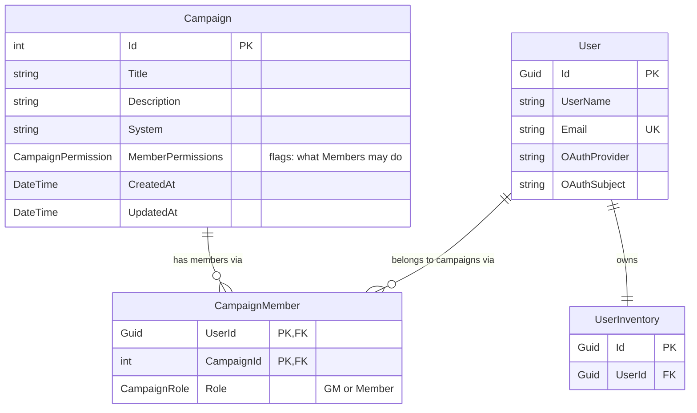

# Entity Relationship Diagram & Decisions

This file tracks the data model and the design decisions behind it.
Update the diagram and add a row to the decisions log whenever the model changes.

## Diagram (planned, RBAC branch)

Only the entities involved in roles and access are shown. Item, MinorItem,
CustomProperty, PropertyOption and ItemPropertyValue still need to be added.

## Decisions log

| # | Date | Decision | Why | Alternatives considered |
|---|------|----------|-----|-------------------------|
| 1 | 2026-11-12 | No site-wide Admin role for now. | Basic per-campaign roles come first; site admin will be discussed later as a team. | Global Admin role on User. |
| 2 | 2026-11-12 | Roles are per campaign, stored in a `CampaignMember` join table (User ↔ Campaign + Role). | A user can be GM of one campaign and a Member of another. | Single `Role` column on User. |
| 3 | 2026-11-12 | Roles are `GM` and `Member`. A GM can do everything in their campaign. | Matches the proposal's GM/Player user stories. | — |
| 4 | 2026-11-12 | The GM sets one permission set for all Members of a campaign (not per member). | Simpler to build and explain; per-member overrides can be added later. | Per-member permissions; role default + per-member overrides. |
| 5 | 2026-11-12 | Member permissions are stored as a `[Flags]` enum column on Campaign. | Compact and quick to check (`HasFlag`). | A permission-rows table. |
| 6 | 2026-11-12 | Replace `User.Role` (`PartyRole`) and `User.PartyId` with `CampaignMember`. Update `UsersController` to match. | One source of truth for roles. | Keep both side by side for a while. |
| 7 | 2026-11-12 | Login and OAuth testing are out of scope for this task. | Separate task. | Dev-only test login. |
| 8 | 2026-11-12 | Starting permissions: `ViewPartyInventory`, `AddItems`, `EditItems`, `DeleteItems`. *(placeholder, review)* | Covers the inventory features that exist today. Encounters can be added when that model exists. | — |
| 9 | 2026-11-12 | `CampaignMember` uses a composite key (`UserId`, `CampaignId`). | Stops a user from being added to the same campaign twice. | Separate `Id` column + unique index. |
| 10 | 2026-11-12 | `PartyRole` renamed to `CampaignRole`; `User.PartyId` removed. | Roles now belong to a campaign, not a party. | — |
| 11 | 2026-11-12 | Register a cookie authentication scheme with no OAuth yet. | `[Authorize]` crashed without any scheme; now it redirects to a login URL instead. | Leave it broken until the OAuth task. |
| 12 | 2026-11-12 | Permission checks use resource-based authorization (`CampaignPermissionHandler`). GM always passes; Member passes if the campaign's `MemberPermissions` has the flag. | Permissions depend on *which* campaign, so a plain `[Authorize(Roles = ...)]` can't express them. | Role claims in the cookie. |
| 13 | 2026-11-12 | Items get linked to a campaign through inventories, not a `CampaignId` on Item. Until then, permission checks in Item, CustomProperty and MinorItem controllers are written but commented out. | Inventories decide where an item lives, so linking now would be redone later. | Required or nullable `CampaignId` on Item. |
| 14 | 2026-11-12 | Added `UseItems` (UseUp, Split) and `ManageProperties` (CustomProperty actions) flags. | Lets a GM allow using items without allowing edits. `ManageProperties` matches the existing TODOs. | Reuse `EditItems` for UseUp/Split. |
| 15 | 2026-11-12 | MinorItem reuses the item flags: `ViewPartyInventory`, `AddItems`, `EditItems`, `DeleteItems`. *(review)* | Keeps the flag list short. | Separate flags for gold/XP. |
| 16 | 2026-11-12 | Delete stays behind `DeleteItems` and is meant to be used rarely. Later: a transaction table logs every change to an Item or MinorItem (created, edited, used up, XP given, gold spent), so items are never truly deleted. | Keeps history for each item. | Hard delete. |
| 17 | 2026-11-12 | The campaign creator becomes GM (written, commented out until OAuth). `CreateCampaign` clears any `Members` sent in the request. | Without clearing, anyone could post themselves in as GM. | — |

## Open questions

- What happens to `Campaign.GameMaster` (a text name) now that the GM comes from `CampaignMember`? (Left in place for now.)
- Is "Party" the same thing as "Campaign"?
- Who creates the first EF Core migration, so teammates don't create conflicting ones?
- `MinorItem.CampaignId` is a `string`, but `Campaign.Id` is an `int`. It needs to be an `int` FK before its checks can be enabled.
- `CustomProperty` has no campaign link yet either. Should properties be per campaign?
- Soft delete (e.g. `IsDeleted`) + transaction table design (decision 16).
- No endpoint yet for a GM to change a campaign's `MemberPermissions`.
